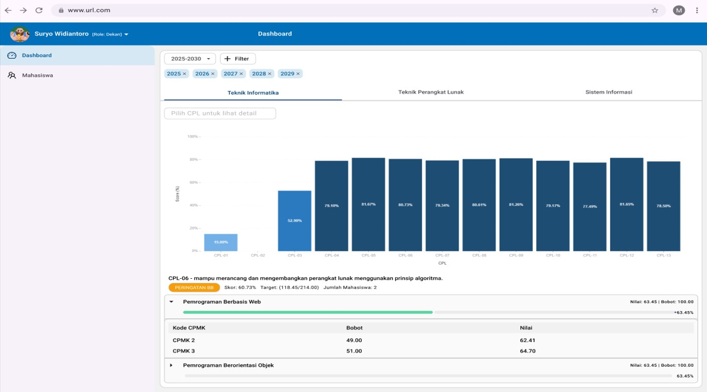
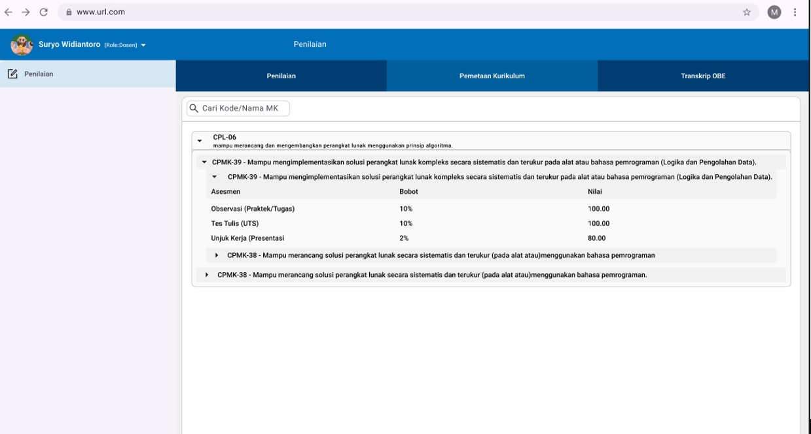

# Description

This project is an undergraduate thesis project focused on the design and implementation of a web-based Outcome-Based Education (OBE) curriculum management system and interface.

The system is designed to calculate the achievement of Graduate Learning Outcomes (CPL) for both students and study programs. It also provides visualization of CPL achievement results through interactive charts and displays the sources contributing to each CPL achievement, including courses, Course Learning Outcomes (CPMK), and Sub-Course Learning Outcomes (Sub-CPMK).

---

# Background

The implementation of the Outcome-Based Education (OBE) curriculum requires study programs to be able to manage, integrate, and present visual achievements of Graduate Learning Outcomes (CPL) clearly.

The Faculty of Computer Science at Universal University has implemented the OBE curriculum; however, currently there is no dedicated interface capable of transparently displaying the mapping process and calculation system of CPL achievements, starting from assessment components, Sub-Course Learning Outcomes (Sub-CPMK), Course Learning Outcomes (CPMK), to Graduate Learning Outcomes (CPL).

Therefore, this project aims to develop a web-based system that can assist study programs in monitoring, analyzing, and visualizing CPL achievement data effectively.

---

# Features

- CPL achievement dashboard
- Detailed CPL achievement table with drill-down functionality
- Automated CPL achievement calculation system
- Data filtering based on:
  - Study program
  - Student cohort
  - Semester
  - Academic period
- Course contribution tracing toward CPL achievement
- Visualization of CPL achievement results using interactive charts

---

# Technology Stack

## Backend

- Node.js
- MongoDB

## Frontend

- Next.js
- TypeScript
- Figma
- Ant Design (Antd)

---

# System Architecture

The system consists of three main components:

1. Frontend Application
   - Developed using Next.js and TypeScript.
   - Responsible for user interaction, visualization, and data presentation.

2. Backend Application
   - Developed using Node.js.
   - Provides REST API services for data processing and business logic.

3. Database
   - Uses MongoDB for storing curriculum data, assessment data, mapping data, and CPL achievement results.


Architecture Flow:

User
 |
 |
Frontend (Next.js)
 |
 |
REST API
 |
 |
Backend (Node.js)
 |
 |
MongoDB Database

---

# Database

# Database

This project uses MongoDB as the primary database management system.

The database is responsible for storing curriculum data, academic information, assessment data, learning outcome mappings, and CPL achievement calculation results.

The main collections used in this system are:

| Collection | Description |
|---|---|
| asesmen | Stores assessment components used for measuring student learning outcomes. |
| cpl | Stores Graduate Learning Outcomes (CPL) data and related information. |
| cpmk | Stores Course Learning Outcomes (CPMK) data and their relationship with CPL. |
| dosen | Stores lecturer information and related academic data. |
| mahasiswa | Stores student information data. |
| mata_kuliah | Stores course information and curriculum-related data. |
| nilai_asesmen | Stores student assessment scores used for CPL achievement calculation. |
| periode_kurikulum | Stores curriculum period information. |
| prodi | Stores study program information. |
| profile_lulusan | Stores graduate profile information related to CPL formulation. |
| subcpmk | Stores Sub-Course Learning Outcomes (Sub-CPMK) data and mapping information. |

---

# How to Run

## 1. Prerequisites

Before running this project, make sure the following software has been installed:

- Node.js
- npm
- MongoDB
- Git


---

# Backend Setup

## 2. Navigate to Backend Directory

Open terminal and navigate to the backend folder:

```bash
cd backend
```

## 3. Install Backend Dependencies

Install all required dependencies:

```bash
npm install
```

## 4. Configure Environment Variables

Create a `.env` file inside the backend directory:

```
backend/
└── .env
```

Configure the MongoDB connection:

```env
MONGODB_URI=your_mongodb_connection_string
```

Example:

```env
MONGODB_URI=mongodb://localhost:27017/curriculum-obe
```

## 5. Run Backend Server

Start the backend server:

```bash
npm run dev
```

The backend service will start running after the command is executed.


---

# Frontend Setup

## 6. Navigate to Frontend Directory

Open a new terminal and navigate to the frontend folder:

```bash
cd frontend
```

## 7. Install Frontend Dependencies

Install all required dependencies:

```bash
npm install
```

## 8. Run Frontend Application

Start the Next.js frontend application:

```bash
npm start
```

The frontend application will be available at:

```
http://localhost:3000
```


---

# Application Access

After both backend and frontend servers are running, open your browser and access:

```
http://localhost:3000
```

The frontend application will communicate with the backend API and MongoDB database to provide the OBE curriculum management system.

--- 

# Application Preview

## Dashboard CPL Achievement



## Mapping Structure

